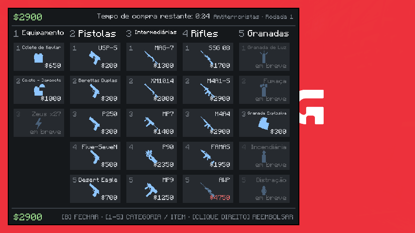
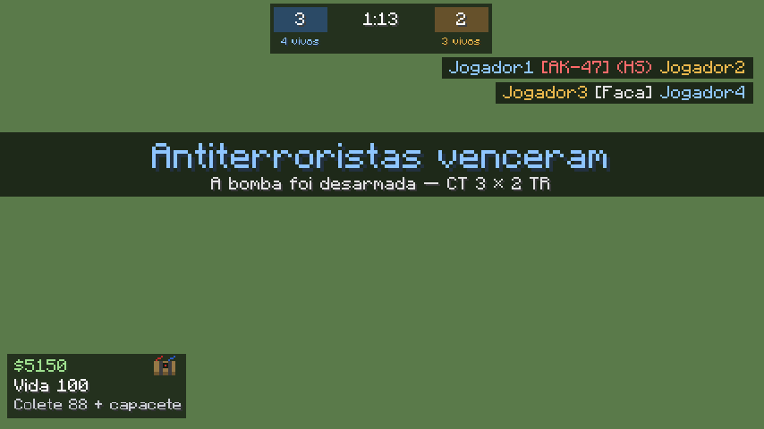

# ShifuStrike

Evento de CS (Terroristas × Antiterroristas) para o servidor **Eclipse Cobblemon**, com as armas do **PointBlank**.
A staff cria a partida, os jogadores entram e o mod cuida do resto: rodadas com compra (tecla **B**), bomba C4,
desarme, economia do CS e placar, até um time chegar a 5 vitórias. No fim, todo mundo recebe o inventário de volta.

- Minecraft 1.21.1 · Fabric · Cobblemon 1.7.3 · PointBlank 2.2.0
- Precisa estar no servidor **e** no cliente (tela de compra, HUD e itens próprios)

## Instalação (ordem importa)

Baixe `shifustrike-1.0.0.jar` em [Releases](../../releases). O mod vai **no servidor e no cliente** de todo jogador,
junto com o **PointBlank 2.2.0** e o **GeckoLib** (≥ 4.5.8). Como ele registra itens próprios (faca, C4, kit), um jogador
sem ele **não consegue entrar no servidor**.

1. Coloque `shifustrike-1.0.0.jar`, o PointBlank e o GeckoLib no modpack/launcher dos jogadores.
2. Só depois que os jogadores atualizarem, suba os mesmos jars para `/mods` do servidor
   (`node "E:/Site Eclipse Cobblemon/ferramentas/tick/subir-mod.mjs" <jar>`) e reinicie.

Dependências: Fabric 1.21.1, Fabric API ≥ 0.116, Fabric Language Kotlin ≥ 1.13.6, Cobblemon ≥ 1.7.3.

## Montar o mapa (uma vez, staff)

Fique no lugar e rode:

| Comando | O que faz |
|---|---|
| `/cs mapa spawn ct` / `/cs mapa spawn tr` | adiciona um spawn (posição e direção). Pode ter vários por time. |
| `/cs mapa bomba a <de> <até>` / `bomba b` | área do bombsite (dois cantos; aceita `~ ~ ~`) |
| `/cs mapa area <de> <até>` | área do mapa inteiro: blocos protegidos, quem é de fora é tirado, quem sai volta |
| `/cs mapa saida` | para onde todos voltam no fim |
| `/cs mapa ver` / `/cs mapa limpar ...` | conferir / apagar pontos |
| `/cs diagnostico` | diz o que falta no mapa e se o PointBlank está carregado |

## Evento

| Comando | Quem | O que faz |
|---|---|---|
| `/cs criar` | staff | abre as inscrições |
| `/cs entrar` / `/cs sair` | todos | entra/sai (sair no meio devolve tudo na hora) |
| `/cs iniciar` | staff | divide os times, guarda o inventário de cada um e começa |
| `/cs cancelar` | staff | encerra e devolve tudo |
| `/cs status` | todos | placar e vivos |
| `/cs recarregar` | staff | relê config e loja (só sem partida) |
| `/cs teste arma <chave>` | staff | dá uma arma da loja carregada (para testar) |

Durante a partida os jogadores só usam `/cs` e mensagens (`/msg`, `/tell`, `/w`, `/r`); o resto (`/home`, `/tpa`, `/spawn`...) fica bloqueado.
O inventário, os Pokémon, o modo de jogo e a vida voltam no fim, inclusive se o servidor cair: a pessoa recebe tudo ao entrar de novo.

## Configuração

- `config/shifustrike/config.json`: tempos (congelamento 10 s, compra 30 s, rodada 1:55, bomba 40 s, plantar 3 s, desarmar 5 s),
  vitórias para vencer (5), dinheiro (início $500, máximo $16000, vitórias, derrotas, bônus de plantio, kills), raios
  (zona de compra 15, desarme 2, explosão da C4 12), colete e a lista de comandos permitidos.
- `config/shifustrike/loja.json`: cada quadrado da tela de compra (nome, preço, posição, arma do PointBlank, munição, pente e reserva).
  Se o arquivo tiver erro, o mod avisa no log e usa a loja padrão. Arma cujo item não existe sai da loja.

## Desenvolvimento

- Copie `pointblank-fabric-1.21-2.2.0.jar` para `libs/` (só no ambiente de dev; nunca vai dentro do nosso jar).
- `./gradlew test` (regras do CS) e `./gradlew runGametest` (partida inteira com jogadores falsos, inclusive dentro de claim do Flan).
- `./gradlew build` gera `build/libs/shifustrike-1.0.0.jar`.
- `SHIFUSTRIKE_PREVIEW=loja|loja_ct|hud ./gradlew runClient` abre a tela com dados de exemplo, salva um print em `run/screenshots/` e fecha.

## Roteiro de teste no jogo (antes de subir)

O que os testes automáticos não conseguem ver. Use dois clientes (`./gradlew runClient` e `./gradlew runClient --args="--username Jogador2"`)
num `runServer` com `online-mode=false`, ou um servidor de teste com o modpack.

- [ ] `/cs criar`, os dois `/cs entrar`, `/cs iniciar`: vão para spawns de times diferentes e o inventário some.
- [ ] 10 s parados; B abre a loja (e não abre nada do Xaero junto; se abrir, troque a tecla em Opções > Controles > CS).
- [ ] Comprar pistola, colete e rifle: o dinheiro desconta; a arma atira **em modo aventura** e recarrega gastando a munição.
- [ ] Clique direito na loja reembolsa; depois de 30 s a loja fecha e B avisa "Fora do tempo de compra".
- [ ] Tiro na cabeça aparece com "(HS)" no feed de kills.
- [ ] Kill de faca: +$1500. A faca aparece com textura e nome.
- [ ] Granada dentro do mapa não quebra bloco nem vidro.
- [ ] `/home` durante a partida é bloqueado; `/msg` funciona.
- [ ] TR planta a C4 no site (barra "Plantando..." de 3 s), aparece "Bomba plantada" e o bip acelera.
- [ ] CT desarma com o kit (barra "Desarmando..." de 5 s). Rodada seguinte: deixar a bomba explodir.
- [ ] A vida e a fome do Minecraft somem durante a partida; o HUD mostra vida, colete e dinheiro.
- [ ] Morto vira espectador preso ao colega; clique troca de colega.
- [ ] Fim da partida: os dois voltam à saída com o inventário e o modo de jogo de antes.
- [ ] Fechar o servidor no meio, subir de novo e entrar: o inventário original volta.
- [ ] No servidor real: o PvP funciona no mapa mesmo dentro do claim do Flan (`/cs diagnostico` não mostra problema).
- [ ] Com o EasyAuth ativo: cair o servidor no meio, entrar de novo e logar: o inventário original volta.
- [ ] Se o modpack tiver slots extras (acessórios, mochila vestida), confira que o que estava neles volta no fim.
